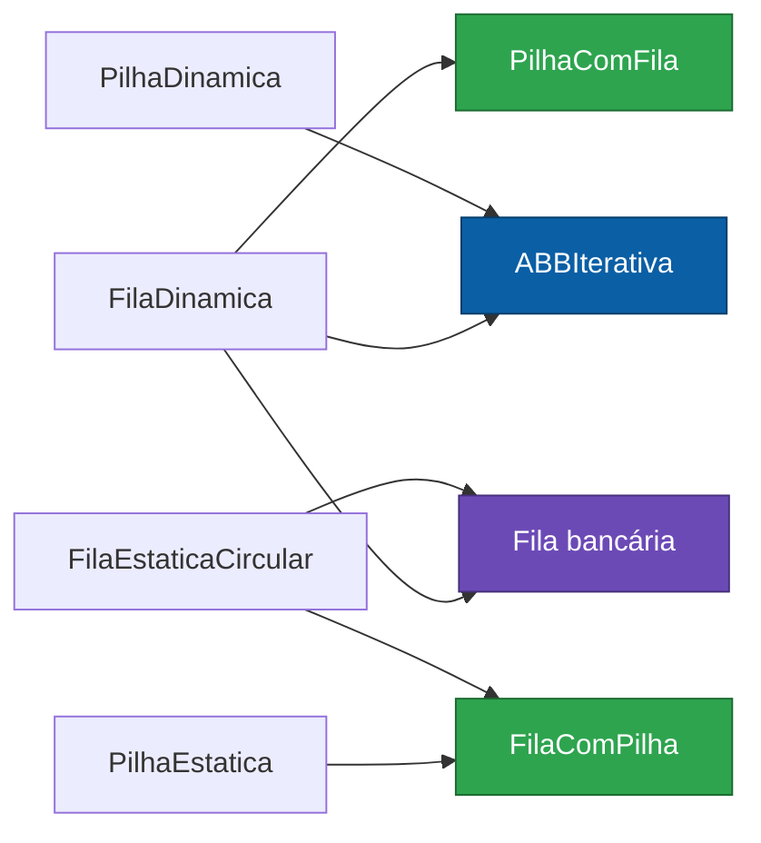

<div align="center">

# Estrutura de Dados

**Listas, pilhas, filas e árvores implementadas à mão em Python, sem atalhos da linguagem.**

Repositório da disciplina **Estrutura de Dados (9893)**, curso de **Engenharia de Software** da Universidade Estadual de Maringá.

<br>


<br>

[Sobre](#sobre-o-repositório) •
[Estrutura](#como-o-repositório-está-organizado) •
[O que tem aqui](#o-que-tem-em-cada-pasta) •
[Como rodar](#como-rodar) •
[Trabalho 1](#trabalho-1-controle-de-estoque-de-um-mercado) •
[Autor](#autor)

</div>

---

## Sobre o repositório

Este repositório guarda tudo o que fiz em Estrutura de Dados ao longo do semestre: os desafios de aula, as práticas de laboratório, as implementações que fui montando para estudar e o trabalho avaliativo.

A regra da disciplina é simples e bem desconfortável no começo: nada de `list.sort()`, nada de `collections.deque`, nada de truques prontos. Cada estrutura é construída do zero, com vetores de tamanho fixo, índices que dão a volta, nós ligados por referências e ponteiros escritos na mão. Foi aí que listas, filas e pilhas deixaram de ser "coisa que o Python já tem" e viraram algo que eu realmente entendo por dentro.

Está tudo em Python, e cada arquivo roda sozinho no terminal.

### Em números

| | |
|---|:---:|
| Pastas de conteúdo | 4 |
| Arquivos Python | 28 |
| Linhas de código (aproximado) | 4.000 |
| Estruturas de dados diferentes | 6 |
| Testes automatizados | 9 |

---

## Como o repositório está organizado

```text
Estrutura-de-Dados/
│
├── Desafios/        Exercícios propostos em aula
│   ├── 01-fibonnaci.py
│   ├── 02-fatorial.py
│   ├── 03-produto-escalar.py
│   ├── 04-encontramenor.py
│   ├── 05-multiplica-matriz.py
│   ├── 09-filaBancaria.py
│   └── 11-listaEstEnc.py
│
├── Práticas/        Atividades de laboratório
│   ├── Pratica04-localizaDeletaSubstituiSubvetor.py
│   ├── pilha-estatica.py
│   ├── pilha-dinamica.py
│   ├── filaEstaticaCircular.py
│   ├── filaDinamica.py
│   └── testaFilaEstDin.py
│
├── Estudos/         Implementações completas, com arquivos de teste
│   ├── pilhaEstatica.py · pilhaDinamica.py · pilhaComFila.py · pilha-testador.py
│   ├── filaEstaticaCircular.py · filaDinamica.py · filaComPilha.py · fila-testador.py
│   ├── listaEstEncOrd.py · listaEstEncOrdBid.py
│   ├── listaDinEncOrd.py · listaDinEncOrdBid.py · lista-testador.py
│   └── ABBIterativa.py
│
└── Trabalhos/       Trabalho avaliativo
    ├── trabalho1.py
    └── testes_da_estrutura.py
```

---

## O que tem em cada pasta

### Desafios

Exercícios que o professor passou em aula. Alguns são curtos, outros viraram programas completos com menu e simulação. A numeração segue a ordem original dos desafios.

| Arquivo | O que resolve |
|---|---|
| `01-fibonnaci.py` | Imprime os `n` primeiros termos da sequência de Fibonacci e a soma deles |
| `02-fatorial.py` | Fatorial de três jeitos: `while`, `for` e recursão |
| `03-produto-escalar.py` | Produto escalar de dois vetores aleatórios, também em `while`, `for` e recursão |
| `04-encontramenor.py` | Procura um vetor menor dentro de um vetor maior, com menu interativo |
| `05-multiplica-matriz.py` | Multiplicação de matrizes, com checagem de dimensões antes de calcular |
| `09-filaBancaria.py` | Simulador de fila de banco, rodando tanto com fila estática circular quanto dinâmica |
| `11-listaEstEnc.py` | Lista estática encadeada: um vetor fixo onde os "ponteiros" são índices |

O simulador de fila bancária é o desafio de que mais gosto. Você define quantos ciclos a simulação dura, o tamanho máximo da fila, a probabilidade de chegar um cliente novo e o tempo máximo de atendimento. No final dá para ver quantos clientes foram atendidos e quantos foram recusados por a fila estar cheia.

### Práticas

Atividades de laboratório. A mais trabalhosa foi a **Prática 04**: localizar, deletar e substituir subvetores dentro de um vetor maior, movendo cada elemento manualmente, sem fatiamento nem métodos prontos.

As outras são as primeiras versões de pilhas e filas (estáticas e dinâmicas), mais o `testaFilaEstDin.py`, que serve para exercitar a fila circular e a dinâmica com a mesma sequência de operações. Basta trocar uma linha de `import` para alternar entre elas.

### Estudos

Aqui estão as versões mais completas e organizadas de cada estrutura, junto com arquivos `*-testador.py` que exercitam as operações pelo terminal.

| Estrutura | Variações implementadas |
|---|---|
| **Pilha** | estática, dinâmica e uma pilha construída **usando uma fila** |
| **Fila** | estática circular, dinâmica e uma fila construída **usando uma pilha** |
| **Lista ordenada** | estática encadeada e dinâmica encadeada |
| **Lista ordenada bidirecional** | estática e dinâmica, com ponteiros para o anterior e o próximo |
| **Árvore binária de busca** | versão **iterativa**, sem recursão |

A árvore (`ABBIterativa.py`) guarda pessoas com nome, CPF e idade e usa o nome como chave. Ela faz inserção, remoção, consulta e atualização, e mostra os itens em ordem, pré-ordem, pós-ordem e em largura. Para os percursos sem recursão ela usa a pilha e a fila dinâmicas que estão na mesma pasta, então um arquivo aproveita o trabalho do outro. O último commit do repositório foi justamente uma rodada de correção de bugs nessa árvore.

### Trabalhos

Contém o trabalho avaliativo e os testes dele. Está detalhado na próxima seção.

---

## Como as estruturas se relacionam

O mapa abaixo mostra quais arquivos reaproveitam outros. A ideia de construir uma estrutura em cima da outra apareceu várias vezes nas aulas.



---

## Trabalho 1: controle de estoque de um mercado

Arquivo: [`Trabalhos/trabalho1.py`](./Trabalhos/trabalho1.py)

É o programa maior do repositório, com cerca de 690 linhas. Ele gerencia o estoque de um mercado usando uma **lista dinâmica encadeada ordenada por nome do produto**. Dois produtos não podem ter o mesmo nome, e a busca ignora diferença entre maiúsculas e minúsculas.

### Dados de cada produto

Cada item guarda nome, categoria, quantidade em estoque, quantidade vendida, valor de custo e valor de venda, além dos totais bruto e líquido.

### Categorias

| Código | Categoria | Código | Categoria |
|:---:|---|:---:|---|
| 1 | Açougue | 6 | Hortifrúti |
| 2 | Padaria | 7 | Grãos, farináceos e café |
| 3 | Frios e laticínios | 8 | Bebidas |
| 4 | Higiene corporal | 9 | Utensílios |
| 5 | Limpeza | 10 | Diversos |

### O que o programa faz

| Operação | Descrição |
|---|---|
| Cadastrar, remover, consultar e atualizar | O básico de uma lista, sempre mantendo a ordem alfabética |
| Registrar venda | Abate do estoque e acumula a quantidade vendida |
| Listar produtos | Mostra a lista inteira |
| Relatório de estoque total | Todos os produtos com suas quantidades |
| Relatório de estoque por tipo | Filtra por categoria |
| Relatório de esgotados | Produtos com estoque zerado |
| Relatório de estoque baixo | Produtos abaixo de um limite que você escolhe |
| Relatório de quantidade vendida | Quanto saiu de cada item |
| Relatório de total bruto e líquido | Faturamento e lucro das vendas |
| Reajuste percentual | Aumenta ou reduz o preço de venda de todos os produtos |
| Reiniciar vendas | Zera os contadores de venda |

### Testes

O arquivo [`testes_da_estrutura.py`](./Trabalhos/testes_da_estrutura.py) tem 9 testes com `unittest`. Eles cobrem lista vazia, inserção ordenada, rejeição de nomes duplicados, remoção, busca, registro de venda e os relatórios.

> **Observação:** na última execução que fiz, 2 desses 9 testes falharam, ambos ligados aos cálculos de total bruto e líquido dos relatórios. Ainda preciso ver se o erro está na lista ou na forma como o teste monta os dados.

---

## Como rodar

### O que você precisa

Python **3.10 ou superior**. O código usa a sintaxe `X | None` nas anotações de tipo, que não existe em versões anteriores. Não há nenhuma dependência para instalar.

### Passo a passo

```bash
# 1. Clone o repositório
git clone https://github.com/henriquesagawauem/Estrutura-de-Dados.git

# 2. Entre na pasta
cd Estrutura-de-Dados
```

### Executando um desafio

```bash
python Desafios/02-fatorial.py
python Desafios/09-filaBancaria.py
```

### Executando o trabalho

```bash
cd Trabalhos
python trabalho1.py
```

### Rodando os testes

Os testes importam o `trabalho1`, então rode de dentro da pasta `Trabalhos`:

```bash
cd Trabalhos
python -m unittest testes_da_estrutura -v
```

### Executando os testadores da pasta Estudos

Os arquivos de estudo importam uns aos outros pelo nome, então também precisam ser executados de dentro da própria pasta:

```bash
cd Estudos
python fila-testador.py
python pilha-testador.py
python lista-testador.py
```

## Autor

<table>
  <tr>
    <td><b>Aluno</b></td>
    <td>Henrique Tutomu Sagawa</td>
  </tr>
  <tr>
    <td><b>RA</b></td>
    <td>152725</td>
  </tr>
  <tr>
    <td><b>E-mail acadêmico</b></td>
    <td><a href="mailto:ra152725@uem.br">ra152725@uem.br</a></td>
  </tr>
  <tr>
    <td><b>E-mail pessoal</b></td>
    <td><a href="mailto:henriquetutomusagawa@gmail.com">henriquetutomusagawa@gmail.com</a></td>
  </tr>
  <tr>
    <td><b>GitHub</b></td>
    <td><a href="https://github.com/HenriqueSagawa">github.com/HenriqueSagawa</a></td>
  </tr>
</table>

## Disciplina

<table>
  <tr>
    <td><b>Disciplina</b></td>
    <td>Estrutura de Dados (9893)</td>
  </tr>
  <tr>
    <td><b>Curso</b></td>
    <td>Engenharia de Software</td>
  </tr>
  <tr>
    <td><b>Professor</b></td>
    <td>Ronaldo Augusto de Lara Gonçalves</td>
  </tr>
  <tr>
    <td><b>Instituição</b></td>
    <td>Universidade Estadual de Maringá (UEM)</td>
  </tr>
</table>

---

<div align="center">

Feito para estudar, errar e entender como as coisas funcionam por dentro.

</div>